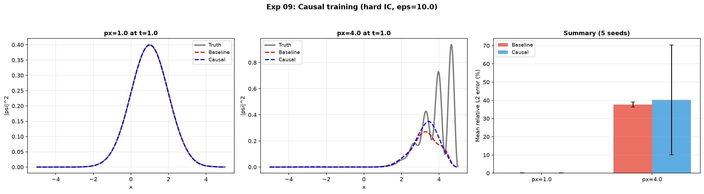

# Where physics-informed neural networks fail on the Schrödinger equation — and the one task where they beat a classical solver

A physics-informed neural network (PINN) is trained to solve the 2D time-dependent
Schrödinger equation for a particle diffracting through a double slit, compared against
a classical split-operator solver. The PINN fails badly on the forward dynamics problem.
This repo characterizes *why* — three candidate failure mechanisms, tested separately —
and then shows the one class of problem where the same PINN machinery genuinely beats
the classical solver: recovering an unknown potential from sparse, noisy data. Along the
way, a suspiciously clean-looking "finding" about the initial-condition formulation
turned out to be a bug — caught before publication, and left in this writeup because the
catch is as much the point as the result.


## The question

Can a PINN replace a classical PDE solver for quantum wave-packet dynamics? The
classical split-operator method is fast, exact (to discretisation error), and has been
the standard tool for this class of problem for decades. PINNs are pitched as a
general-purpose alternative that needs no mesh and no numerical scheme, just the PDE
residual as a loss function. Does that generality hold up here?

## The failure

The PINN is trained on the same double-slit setup as the classical solver (px=-15, a
fast-moving wave packet) and compared against it directly. Under the best of three
formulations actually measured (see the methodology note below), the PINN reaches
**99.96% mean relative error** against the classical ground truth, and takes **~267
seconds to train versus ~0.5–2 seconds** for the classical solver to run — roughly two
to three orders of magnitude slower, for a wrong answer. It fails just as badly under
the other two formulations tested (99.78% and 272.89% — see below): this is not a
tuning artifact of one bad hyperparameter choice.


## Methodology note: a bug that nearly became a headline finding

This repo's original code mixed two ways of enforcing the initial condition (IC): the
2D solver used a *soft* IC (a penalty term, `loss = loss_pde + w_ic · loss_ic`, with an
arbitrary, untested weight of 1000), while the earlier 1D diagnosis used a *hard* IC
(ψ = ψ₀ + t·net, exact by construction, no weight to tune). Before making any headline
claim, `exp08_ic_formulation.py` tested both head-to-head in a controlled 1D setting.

**First pass, and a near-miss.** The first run reversed the expectation: hard IC —
despite satisfying the initial condition exactly — reached only **77.2% mean error**,
while the most lightly weighted soft IC (w=1) reached **2.2% mean error**, with error
increasing monotonically with more IC weight. A follow-up investigation found the
failure was deterministic and seed-independent, and concluded this was a real
optimization pathology — hard IC converging onto a reproducible "non-propagating
attractor" — plausible enough to write up as evidence for causality violation.

**It wasn't a pathology. It was a bug.** A closer audit found `psi0_at()`, used to build
hard IC's `ψ = ψ₀ + t·net`, computed ψ₀ via a numpy round-trip on a *detached* tensor —
so its spatial derivative was invisible to autograd. The hard-IC PDE residual needs
`∂²ψ₀/∂x²` as a source term; with it silently zeroed, `net ≡ 0` (a wavefunction frozen at
its t=0 shape forever) became the *exact global minimizer* of the training objective.
That one detached tensor reproduces every symptom that looked like a real pathology:
near-machine-precision training loss on a physically wrong answer, a reproducible
non-propagating attractor independent of random seed, and error growing with momentum.
Fixed (ψ₀ computed directly in torch, so autograd sees it), then re-run:

| Formulation | Mean error (1D, px=2) |
|---|---|
| Hard IC (ψ = ψ₀ + t·net) | **1.09%** |
| Soft IC, w=1 | 2.03% |
| Soft IC, w=1000 (original) | 15.31% |

Hard IC now wins, exactly as the original plan predicted before any experiment ran. The
earlier "finding" — soft beats hard, and hard IC exhibits a causality-linked attractor —
is retracted; it was the bug's signature, not physics. A second, smaller issue was fixed
at the same time: the ground truth for high-momentum cases used a soft potential wall
that diverged from the PINN's actual (infinite-well) boundary assumption once the wave
packet reached it — replaced with an exact Dirichlet sine-series solution.


**Hard IC was adopted for the 1D mechanism experiments below — but it does not transfer
to 2D.** Re-running the full 2D headline comparison under all three formulations:

| Formulation | Mean rel. error |
|---|---|
| Hard IC (1D-adopted, bug fixed) | 272.89% |
| Soft IC, w=1 | **99.96%** |
| Soft IC, w=1000 (original) | 99.78% |

The formulation that decisively wins the simple 1D free-particle problem is the *worst*
of the three in the real 2D problem, which has actual potential structure (confining
walls, a circular barrier, a double slit) that the bare 1D setting never did — the
hard-IC training loss doesn't even converge cleanly there. The 2D failure reported above
uses the best of the three measured (soft IC, w=1), per this repo's standing policy of
reporting the strongest formulation actually tested rather than a strawman — and all
three still fail badly (99.78%–272.89%). Formulation choice turns out to be
problem-dependent, not a universal fact about hard vs. soft ICs — a nuance the original,
bug-driven "soft wins" conclusion papered over by accident.

## The diagnosis: three candidate mechanisms, tested separately

The 2D setup uses px=-15 — a genuinely fast-moving wave packet. The 1D diagnosis breaks
the failure down into three candidate mechanisms and tests each with a dedicated,
falsifiable experiment, all run under the corrected, adopted (hard) IC formulation.

**Spectral bias** (`exp06_momentum_sweep.py`) — do networks struggle more as the wave
packet's momentum increases? Swept px ∈ {0.5, 1, 2, 4}, 5 seeds each:

| px | Mean error |
|---|---|
| 0.5 | 0.26% ± 0.05% |
| 1.0 | 0.19% ± 0.04% |
| 2.0 | 1.09% ± 0.11% |
| 4.0 | **37.68% ± 1.35%** |

Confirmed, and dramatically so: error stays under 1.1% through px=2, then grows ~35x
between px=2 and px=4. (px=0.5→1.0 dips slightly rather than rising — both values are
under 0.3% and close enough to read as noise at the floor of what this architecture can
achieve on an easy problem, not a real reversal; reported honestly rather than smoothed
over.) At px=-15 (the 2D setup), this trend extrapolates straight into the near-total
failure observed above.


**Amplitude decay** (`exp07_norm_constraint.py`) — ψ≡0 trivially satisfies the PDE
residual, so a time-dependent PINN could let probability leak away over time instead of
conserving it. Added a unitarity loss term (penalizing deviation of ∫|ψ|²dx from 1) and
compared against baseline at px ∈ {1, 4}. At px=4, baseline norm genuinely collapses
(N(t): 1.0 → ~0.5 by t=1) and the constraint holds it much closer to 1 (~0.82) — and this
time, unlike the bug-contaminated first pass, the fix actually **helps overall accuracy**
(37.7% → 31.6% at λ=1, 37.7% → **29.0%** at λ=0.1). At px=1 there's no real amplitude
decay to fix, so the same constraint just adds noise and hurts (0.19% → 1.24%). Pushing
λ too high overcorrects and hurts regardless of momentum (λ=10 → 54.6% at px=4). This is
the cleanest "does what it says on the tin" result of the three: a real, targeted
physics-based fix that earns its keep exactly where the diagnosed problem is real.


**Causality violation** (`exp09_causal_training.py`) — collocation times are sampled
uniformly at random, so nothing in training enforces that the solution at time t builds
on the solution before it. Implemented causal weighting (later time bins down-weighted
until earlier ones are fit) and compared against baseline at px ∈ {1, 4}. At px=1, no
effect (0.19%→0.18%) — there's no propagation failure left to fix under correct hard IC.
At px=4 the 5-seed mean looks like a wash (37.7%→40.3%), but that average is misleading:
**4 of 5 seeds improved substantially** (37.7%→~25.2%, roughly a third lower) while **1
seed diverged catastrophically to 100.6% error**. Causal training has real upside at high
momentum most of the time, but an unresolved training-instability failure mode (1-in-5
in this small sample) — not the "no effect" story a naive read of the mean would suggest,
and not reliable enough to recommend without further work (e.g. gradient clipping or a
warm-up schedule) that's out of scope here.



**Net picture:** spectral bias is the dominant, confirmed mechanism, and it alone
explains the near-total 2D failure at px=-15. Amplitude decay is real at high momentum
and a correctly-tuned penalty term measurably fixes it. Causal training has genuine
promise but an unresolved stability problem. None of the three "fixes" comes close to
closing the gap implied by the momentum sweep — spectral bias remains the story.

## The control: eigenstates work

Stationary eigenstates (infinite square well and harmonic oscillator, zero net momentum,
no time evolution) are the regime with the failure mode's key variable — oscillation
frequency — removed. Trained via Rayleigh-quotient minimization, compared against exact
finite-difference diagonalization, 5 seeds:

- Worst-case PINN energy error: **1.21% ± 0.32%** (worst single seed: 1.51%)
- Worst-case PINN ψ L2 error: **1.99% ± 0.16%**

The same network architecture that fails at high-momentum dynamics matches the exact
analytic/finite-difference solution here. This pins the boundary: the failure is about
representing fast oscillations, not a general defect in the PINN machinery. (This
experiment doesn't share any code path with the IC-formulation bug above, so these
numbers are unaffected by the correction.)


## Where PINNs win: the inverse problem

A classical forward solver maps a potential V(x) to a wavefunction ψ(x). It has no
native way to run that backwards. A PINN does: make V(x) a second network, and let the
same physics loss that constrains ψ also constrain V, in one training run. Tested by
recovering an unknown potential (a Gaussian barrier) from 40 sparse, 3%-noise
wavefunction samples plus the known ground-state energy, 5 seeds:

- PINN reconstruction: **14.99% ± 3.82%** relative L2 error (seed range: 10.4%–21.2%)
- Naive baseline (differentiate the noisy data directly, `V = E + ψ''/ψ`, given *more*
  data): fails outright — numerically unstable, dominated by noise

(Also unaffected by the IC-formulation correction — a separate solver, no shared code.)


## Takeaways

- **Vanilla PINNs on this problem lose badly to a classical solver on forward dynamics**
  — two to three orders of magnitude slower, ~100% error at the momentum this repo's 2D
  demo uses — and that holds under the best formulation actually tested, across all
  three formulations measured (99.78%–272.89%), not just a weak strawman.
- **The failure is dominated by spectral bias**, confirmed by a clean momentum sweep.
  Amplitude decay is real at high momentum and, this time, genuinely fixable with a
  correctly-weighted penalty term. Causal training shows real promise but has an
  unresolved stability problem. None of the three fixes closes the gap implied by
  spectral bias.
- **A near-machine-precision training loss on a physically wrong answer is a bug smell,
  not evidence of a subtle optimization pathology.** The single most consequential
  moment in this project was almost publishing "hard IC exhibits a causality-linked
  non-propagating attractor" — a plausible-sounding, well-evidenced, entirely wrong
  conclusion, caused by one `.detach()` silently dropping a source term from a PDE
  residual. The fix: when a loss converges suspiciously well on a solution that's
  obviously physically wrong, audit the loss computation's autograd graph before
  concluding anything about optimization dynamics.
- **PINNs are the right tool for the inverse problem, not the forward one, here.**
  Use a PINN when you need to fuse sparse/noisy data with known physics or solve an
  inverse problem a mesh-based method can't touch directly. Use the classical solver
  when you just need to propagate a wave packet forward — it's both faster and correct.

## Threats to validity

- **Single architecture.** All PINNs here are vanilla MLPs with `tanh` activations.
  Architectures designed for high-frequency functions (Fourier feature embeddings,
  SIREN) are known partial fixes for spectral bias and were deliberately not attempted
  — see "Out of scope" in `IMPLEMENTATION_PLAN.md`.
- **Modest, roughly-matched tuning budget.** Both methods got similar iteration counts
  and a small amount of hyperparameter exploration, not an exhaustive search either way.
- **1D diagnosis extrapolated to 2D.** The three mechanism experiments (exp06/07/09) run
  in 1D for cost reasons. The IC-formulation study (exp08) and the 2D re-run (Task 2.2)
  mitigate this for the headline failure claim, but the mechanism decomposition itself
  (amplitude / causality / spectral bias) is only verified in 1D. The 2D re-run also
  shows formulation choice doesn't transfer cleanly between the two settings, which is a
  reason for some caution about extrapolating the mechanism results too.
- **Fixed causal-weighting hyperparameters.** `exp09` uses a fixed bin count (M=10) and
  ε=10 with no further tuning, and its high-momentum instability (1 diverged seed of 5)
  was not investigated further — both out of scope (see `IMPLEMENTATION_PLAN.md`).
- **Nearest-neighbor potential interpolation** in the 2D PINN (`qbox/pinn2d.py`) is a
  coarse way to hand the potential to autograd; a smoother interpolation might change
  the 2D numbers slightly, though not the qualitative failure.
- **2D comparison is single-seed** (deliberately — it's expensive and its role in this
  repo is qualitative, not a statistical claim); the 1D experiments that inform the
  quantitative claims all use 5 seeds.
- **The hard-IC 2D non-convergence is observed, not root-caused.** Training loss
  oscillates rather than decreasing smoothly; whether more epochs, a learning-rate
  schedule, or a different architecture would close the gap to soft IC is an open
  question, not investigated here (out of scope).

## References

- Raissi, M., Perdikaris, P., & Karniadakis, G.E. (2019). *Physics-informed neural
  networks: A deep learning framework for solving forward and inverse problems involving
  nonlinear partial differential equations.* Journal of Computational Physics.
- Krishnapriyan, A., Gholami, A., Zhe, S., Kirby, R., & Mahoney, M.W. (2021).
  *Characterizing possible failure modes in physics-informed neural networks.* NeurIPS.
- Rahaman, N., et al. (2019). *On the Spectral Bias of Neural Networks.* ICML.
- Wang, S., Teng, Y., & Perdikaris, P. (2021). *Understanding and mitigating gradient
  flow pathologies in physics-informed neural networks.* SIAM Journal on Scientific
  Computing.
- Wang, S., Sankaran, S., & Perdikaris, P. (2022). *Respecting causality is all you need
  for training physics-informed neural networks.* arXiv:2203.07404.

## Reproduce it

```bash
uv sync
uv run experiments/run_all.py          # exp03, exp08, exp04-09 (skips the slow 2D ones)
uv run experiments/exp01_classical_2d.py
uv run experiments/exp02_pinn2d_comparison.py --formulation soft --w-ic 1.0 --epochs 2000
uv run experiments/exp02_pinn2d_comparison.py --formulation hard --epochs 2000
```

`exp01`/`exp02` are excluded from `run_all.py` because the 2D comparison is by far the
slowest part of the pipeline (~5 minutes per formulation for the PINN alone); run them
explicitly if you want the 2D figures. Multi-seed error bars for `exp04`/`exp05` (Task
2.6) are produced by re-running with `--seed 1..4`. Full verified numbers, including
everything not shown in this README, are in `RESULTS.md`.
