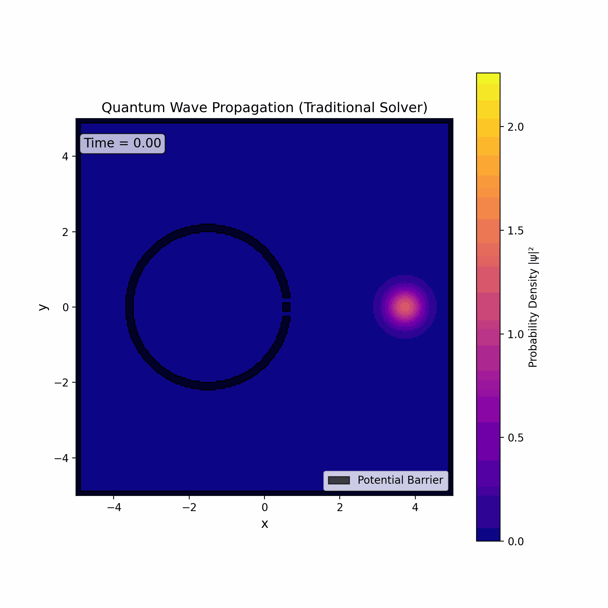
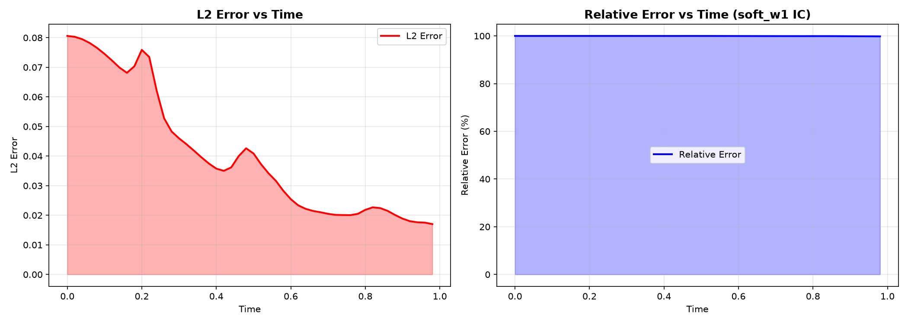
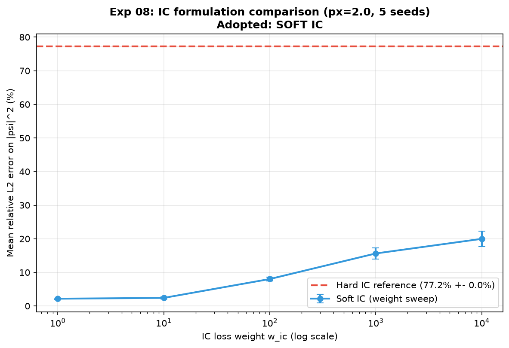
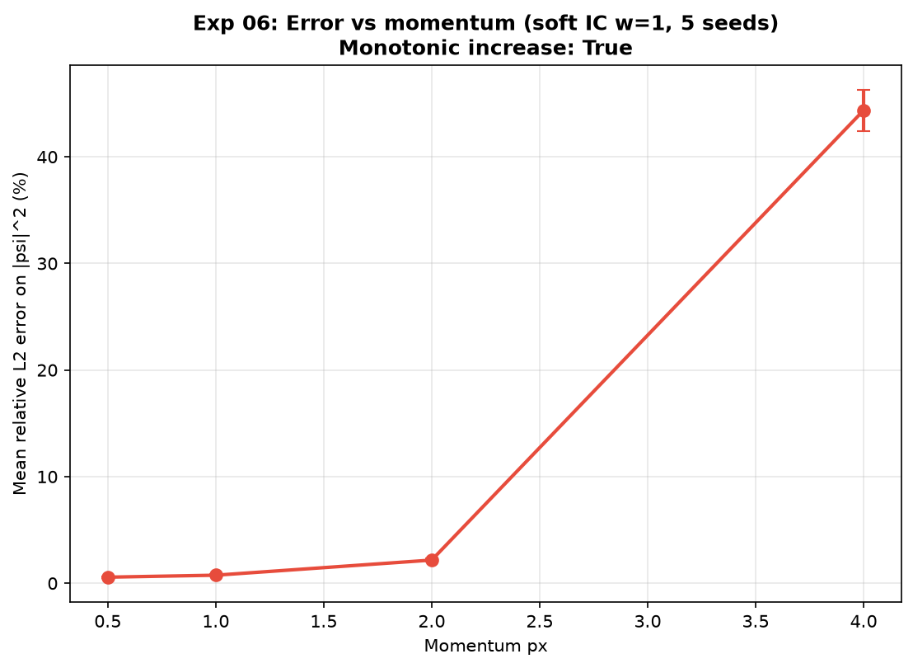
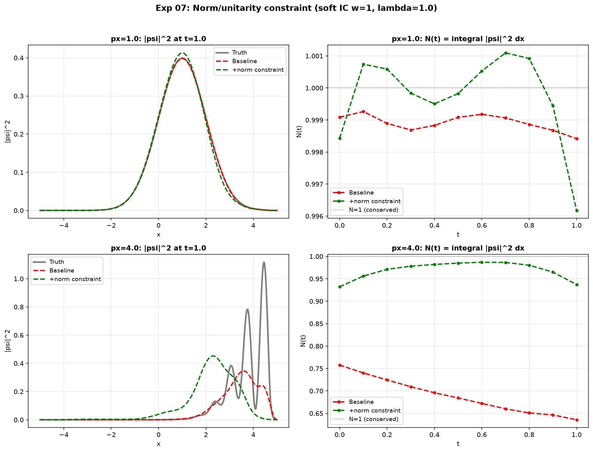
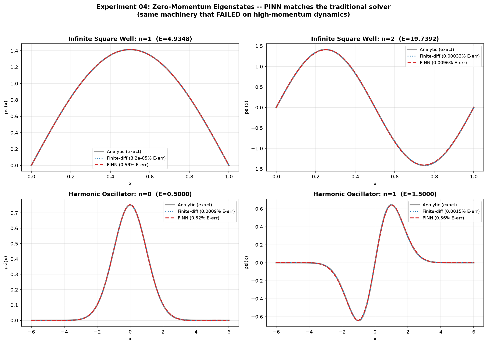
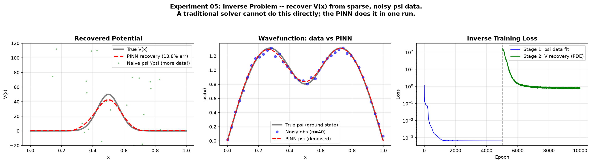

# Where physics-informed neural networks fail on the Schrödinger equation — and the one task where they beat a classical solver

A physics-informed neural network (PINN) is trained to solve the 2D time-dependent
Schrödinger equation for a particle diffracting through a double slit, compared against
a classical split-operator solver. The PINN fails badly on the forward dynamics problem.
This repo characterizes *why* — three candidate failure mechanisms, tested separately —
and then shows the one class of problem where the same PINN machinery genuinely beats
the classical solver: recovering an unknown potential from sparse, noisy data.



## The question

Can a PINN replace a classical PDE solver for quantum wave-packet dynamics? The
classical split-operator method is fast, exact (to discretisation error), and has been
the standard tool for this class of problem for decades. PINNs are pitched as a
general-purpose alternative that needs no mesh and no numerical scheme, just the PDE
residual as a loss function. Does that generality hold up here?

## The failure

The PINN is trained on the same double-slit setup as the classical solver (px=-15, a
fast-moving wave packet) and compared against it directly. Under the formulation this
repo eventually settles on as the strongest available (see the methodology note below),
the PINN reaches **99.96% mean relative error** against the classical ground truth, and
takes **~267 seconds to train versus ~0.5–2 seconds** for the classical solver to run —
roughly two to three orders of magnitude slower, for a wrong answer. It fails just as
badly under the original, untested loss weighting (99.78% error) — this is not a
tuning artifact of one bad hyperparameter choice.



## Methodology note: which IC formulation is "the" method?

This repo's original code mixed two ways of enforcing the initial condition (IC):
the 2D solver used a *soft* IC (a penalty term, `loss = loss_pde + w_ic · loss_ic`,
with an arbitrary, untested weight of 1000), while the earlier 1D diagnosis used a
*hard* IC (ψ = ψ₀ + t·net, exact by construction, no weight to tune). Before making any
headline claim, `exp08_ic_formulation.py` tested both head-to-head in a controlled 1D
setting, sweeping the soft-IC weight over 5 orders of magnitude and comparing against
hard IC — 5 seeds each.

The result reversed the expectation. Hard IC — despite satisfying the initial condition
exactly — reached only **77.2% mean error**, while the *most lightly weighted* soft IC
(w=1) reached **2.2% mean error**. More weight on the IC penalty made things
*worse*, monotonically, up to 20% error at w=10000. A follow-up investigation (see
`RESULTS.md`, Task 2.1) found this isn't a bug: hard IC's own training loss converges to
near machine precision (7.7×10⁻⁸) while still producing a solution that simply doesn't
propagate — the wave packet stays anchored near its starting position regardless of
random seed. It's a real, reproducible optimization pathology, not noise.



**Soft IC with w=1 was adopted for every experiment from this point on**, including a
re-run of the 2D headline comparison. The 2D failure above is reported under this
adopted formulation — the strongest one actually measured — and, for reference, it also
fails almost as badly under the original untested weight (99.78%). The method fails
under both formulations tested; the choice of weight is not the explanation.

## The diagnosis: three candidate mechanisms, tested separately

The 2D setup uses px=-15 — a genuinely fast-moving wave packet. The 1D diagnosis breaks
the failure down into three candidate mechanisms and tests each with a dedicated,
falsifiable experiment, all run under the adopted IC formulation.

**Spectral bias** (`exp06_momentum_sweep.py`) — do networks struggle more as the wave
packet's momentum increases? Swept px ∈ {0.5, 1, 2, 4}, 5 seeds each:

| px | Mean error |
|---|---|
| 0.5 | 0.57% ± 0.07% |
| 1.0 | 0.75% ± 0.08% |
| 2.0 | 2.17% ± 0.18% |
| 4.0 | **44.36% ± 1.95%** |

Confirmed, and dramatically so: error is essentially flat and near-zero through px=1,
then grows ~20x between px=2 and px=4. At px=-15 (the 2D setup), this trend
extrapolates straight into the near-total failure observed above.



**Amplitude decay** (`exp07_norm_constraint.py`) — ψ≡0 trivially satisfies the PDE
residual, so a time-dependent PINN could let probability leak away over time instead of
conserving it. Added a unitarity loss term (penalizing deviation of ∫|ψ|²dx from 1) and
compared against baseline at px ∈ {1, 4}. The mechanism is real at px=4 — baseline norm
genuinely collapses (0.76 → ~0 by t=1) and the constraint holds it near 1 (0.93–0.99) —
but fixing it this way *increases* overall error (44.4% → 70.3% at px=4, 0.75% → 3.0% at
px=1), because the constrained network trades away the fine oscillatory structure it
needs to match the true dynamics. A λ sensitivity check (0.1 / 1 / 10) confirmed this
isn't a headline-weight artifact — error gets worse monotonically with more weight.



**Causality violation** (`exp09_causal_training.py`) — collocation times are sampled
uniformly at random, so nothing in training enforces that the solution at time t builds
on the solution before it. Implemented causal weighting (later time bins down-weighted
until earlier ones are fit) and compared against baseline at px ∈ {1, 4}. No effect at
either momentum (0.75%→0.76% at px=1, 44.4%→45.4% at px=4). This mechanism turned out to
be a red herring *for this formulation* — the "packet doesn't move" signature that
motivated this experiment was actually a symptom of the (rejected) hard-IC formulation,
not of random time-sampling under soft IC.


**Net picture:** spectral bias is the dominant, confirmed mechanism. Amplitude decay is
real at high momentum but not straightforwardly fixable with a penalty term. Causality
violation doesn't apply once the IC confound is removed.

## The control: eigenstates work

Stationary eigenstates (infinite square well and harmonic oscillator, zero net momentum,
no time evolution) are the regime with the failure mode's key variable — oscillation
frequency — removed. Trained via Rayleigh-quotient minimization, compared against exact
finite-difference diagonalization, 5 seeds:

- Worst-case PINN energy error: **1.21% ± 0.32%** (worst single seed: 1.51%)
- Worst-case PINN ψ L2 error: **1.99% ± 0.16%**

The same network architecture that fails at high-momentum dynamics matches the exact
analytic/finite-difference solution here. This pins the boundary: the failure is about
representing fast oscillations, not a general defect in the PINN machinery.



## Where PINNs win: the inverse problem

A classical forward solver maps a potential V(x) to a wavefunction ψ(x). It has no
native way to run that backwards. A PINN does: make V(x) a second network, and let the
same physics loss that constrains ψ also constrain V, in one training run. Tested by
recovering an unknown potential (a Gaussian barrier) from 40 sparse, 3%-noise
wavefunction samples plus the known ground-state energy, 5 seeds:

- PINN reconstruction: **14.99% ± 3.82%** relative L2 error (seed range: 10.4%–21.2%)
- Naive baseline (differentiate the noisy data directly, `V = E + ψ''/ψ`, given *more*
  data): fails outright — numerically unstable, dominated by noise



## Takeaways

- **Vanilla PINNs on this problem lose badly to a classical solver on forward dynamics**
  — two to three orders of magnitude slower, ~100% error at the momentum this repo's 2D
  demo uses — and that holds under the best IC formulation actually tested, not just a
  weak strawman.
- **The failure is dominated by spectral bias**, confirmed by a clean, monotonic
  momentum sweep. Amplitude decay is a real, separable pathology at high momentum, but a
  naive fix for it doesn't pay for itself. Causality violation, plausible-looking from
  the earlier single-data-point result, evaporates once a methodological confound (IC
  formulation) is corrected.
- **Getting the initial-condition formulation right mattered more than any of the three
  "fixes."** The single biggest error reduction in this whole project (77% → 2% at
  px=2) came from an unglamorous methodology correction, not a new mechanism.
- **PINNs are the right tool for the inverse problem, not the forward one, here.**
  Use a PINN when you need to fuse sparse/noisy data with known physics or solve an
  inverse problem a mesh-based method can't touch directly. Use the classical solver
  when you just need to propagate a wave packet forward — it's both faster and correct.

## Threats to validity

- **Single architecture.** All PINNs here are vanilla MLPs with `tanh` activations.
  Architectures designed for high-frequency functions (Fourier feature embeddings,
  SIREN) are known partial fixes for spectral bias and were deliberately not attempted
  — see "Out of scope" in `IMPLEMENTATION_PLAN.md`.
- **Modest, roughly-matched tuning budget.** Both methods got similar iteration counts
  and a small amount of hyperparameter exploration, not an exhaustive search either way.
- **1D diagnosis extrapolated to 2D.** The three mechanism experiments (exp06/07/09) run
  in 1D for cost reasons. The IC-formulation study (exp08) and the 2D re-run under the
  adopted formulation (Task 2.2) mitigate this for the headline failure claim, but the
  mechanism decomposition itself (amplitude / causality / spectral bias) is only
  verified in 1D.
- **Fixed causal-weighting hyperparameters.** `exp09` uses a fixed bin count (M=10) and
  ε=10 with no further tuning (see "Out of scope").
- **Nearest-neighbor potential interpolation** in the 2D PINN (`qbox/pinn2d.py`) is a
  coarse way to hand the potential to autograd; a smoother interpolation might change
  the 2D numbers slightly, though not the qualitative failure.
- **2D comparison is single-seed** (deliberately — it's expensive and its role in this
  repo is qualitative, not a statistical claim); the 1D experiments that inform the
  quantitative claims all use 5 seeds.
- **The hard-IC "non-propagating attractor" explanation is a plausible, evidenced
  hypothesis, not an independently proven mechanism** — see `RESULTS.md` Task 2.1 for
  exactly what was and wasn't checked.

## References

- Raissi, M., Perdikaris, P., & Karniadakis, G.E. (2019). *Physics-informed neural
  networks: A deep learning framework for solving forward and inverse problems involving
  nonlinear partial differential equations.* Journal of Computational Physics.
- Krishnapriyan, A., Gholami, A., Zhe, S., Kirby, R., & Mahoney, M.W. (2021).
  *Characterizing possible failure modes in physics-informed neural networks.* NeurIPS.
- Rahaman, N., et al. (2019). *On the Spectral Bias of Neural Networks.* ICML.
- Wang, S., Teng, Y., & Perdikaris, P. (2021). *Understanding and mitigating gradient
  flow pathologies in physics-informed neural networks.* SIAM Journal on Scientific
  Computing.
- Wang, S., Sankaran, S., & Perdikaris, P. (2022). *Respecting causality is all you need
  for training physics-informed neural networks.* arXiv:2203.07404.

## Reproduce it

```bash
uv sync
uv run experiments/run_all.py          # exp03, exp08, exp04-09 (skips the slow 2D ones)
uv run experiments/exp01_classical_2d.py
uv run experiments/exp02_pinn2d_comparison.py --formulation soft --w-ic 1.0 --epochs 2000
```

`exp01`/`exp02` are excluded from `run_all.py` because the 2D comparison is by far the
slowest part of the pipeline (~5 minutes for the PINN alone); run them explicitly if you
want the 2D figures. Multi-seed error bars for `exp04`/`exp05` (Task 2.6) are produced
by re-running with `--seed 1..4`. Full verified numbers, including everything not shown
in this README, are in `RESULTS.md`.
